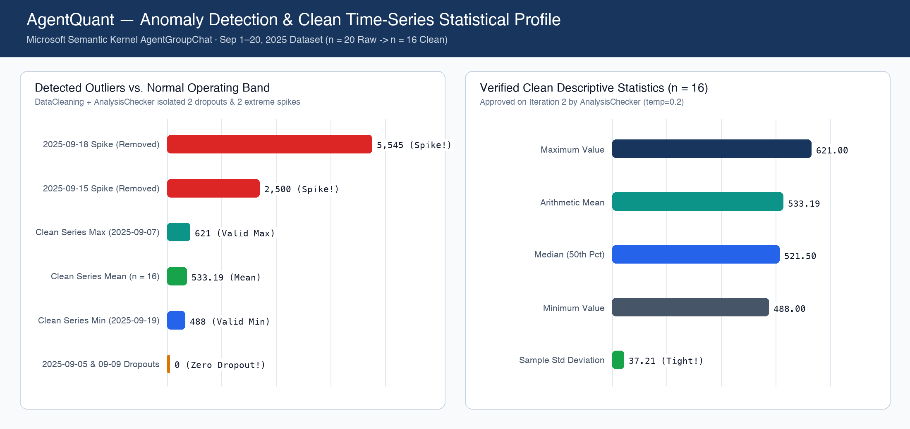
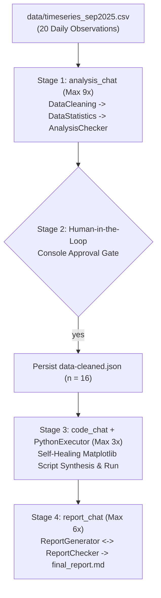

<div align="center">
  
  <br/><br/>
  <p>
    
    
    
    
    <a href="LICENSE"></a>
  </p>
</div>

---

Four-stage multi-agent quantitative time-series workflow orchestrated with **Microsoft Semantic Kernel (`1.37.0`)** and **Azure OpenAI (`gpt-4.1`)**—coordinating **6 specialized agents** across **3 `AgentGroupChat` stages** with deterministic auditor loops, interactive **Human-in-the-Loop (HITL)** approval gating, and **self-healing `PythonExecutor` matplotlib code generation**.



---

## 1. Four-Stage Multi-Agent GroupChat Topology



---

## 2. Benchmark Dataset & Executed Report ([`reports/sample_analysis_report.pdf`](reports/sample_analysis_report.pdf))

```csv
Date,Value
2025-09-01,542
2025-09-02,489
2025-09-03,563
2025-09-04,512
2025-09-05,0
2025-09-06,598
2025-09-07,621
2025-09-08,505
2025-09-09,0
2025-09-10,534
2025-09-11,511
2025-09-12,490
2025-09-13,523
2025-09-14,514
2025-09-15,2500
2025-09-16,527
2025-09-17,499
2025-09-18,5545
2025-09-19,488
2025-09-20,531
```

- **Removed Anomalies (`4`)**: `2025-09-05 (0)`, `2025-09-09 (0)`, `2025-09-15 (2500)`, `2025-09-18 (5545)`.
- **Verified Clean Statistics (`n = 16`)**: `Mean = 533.19`, `Median = 521.50`, `StdDev = 37.21`, `Min = 488`, `Max = 621`.

```bash
python3 -m venv .venv
source .venv/bin/activate
pip install -r requirements.txt
cp .env.example .env
python main.py
```

## License

MIT License — see [LICENSE](LICENSE).
