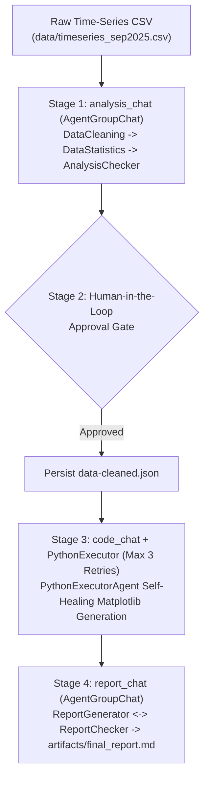

# AgentQuant: Multi-Agent Time-Series Cleaning, Audit & Self-Healing Visualization Pipeline

Four-stage multi-agent quantitative data analysis workflow built on **Microsoft Semantic Kernel (`1.37.0`)** and **Azure OpenAI (`gpt-4.1`)**—coordinating **6 specialized agents** across **3 `AgentGroupChat` topologies** with deterministic auditor feedback loops, interactive **Human-in-the-Loop (HITL)** approval gating, and **self-healing `PythonExecutor` matplotlib code generation**.

---

## Multi-Agent GroupChat Architecture

---

